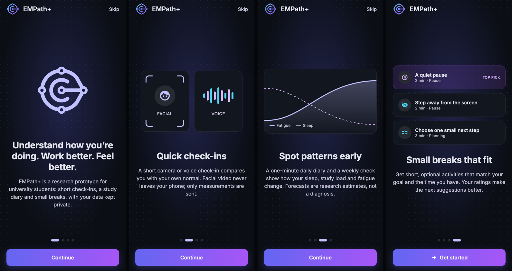

<h1 align="center">
  
</h1>

<p align="center">
  Research prototype for student wellbeing support: a shared backend and a mobile app.
</p>

<p align="center">
  
  <br>
  <sub>Mobile app launch screens: welcome · quick check-ins · spotting patterns · small breaks</sub>
</p>

## What's inside

| Folder | Contents | Status |
|---|---|---|
| [`backend/`](backend/) | FastAPI + SQLite REST API with the four research components | Implemented (API 0.4.0) · [backend/README.md](backend/README.md) |
| [`mobile/`](mobile/) | Expo (React Native) app that calls the backend API | Test app with demo data or real camera/microphone capture · [mobile/README.md](mobile/README.md) |

## Components

| | Component | What it does |
|---|---|---|
| **C1** | Facial | Compares facial movement with your own calm reference (measured on the phone; video never leaves it) |
| **C2** | Voice | Extracts acoustic features from a short speech sample and an acted-speech style |
| **C3** | Risk | Daily diary and weekly check, then an exploratory next-week exhaustion forecast |
| **C4** | Activities | Short optional breaks ranked by your goal, time, preferences and ratings |

## Quick start

**Backend** (64-bit Python 3.12):

```bash
cd backend
python3.12 -m venv .venv
source .venv/bin/activate          # Windows: .venv\Scripts\activate.bat
python -m pip install -r requirements-tested.txt
cp .env.example .env               # Windows: copy .env.example .env
python -m alembic upgrade head
python -m uvicorn app.main:app --host 0.0.0.0 --port 8000 --reload
```

Then open <http://127.0.0.1:8000/docs>. Full setup, demos, tests and troubleshooting: [backend/README.md](backend/README.md).

**Mobile** (Node 20+ and Expo Go on your phone, same Wi-Fi as the laptop):

```bash
cd mobile
npm install
npx expo start -c
```

Scan the QR code, go through the launch screen, then connect on the **Profile** tab. Details: [mobile/README.md](mobile/README.md).

> [!IMPORTANT]
> Research prototype. No component is a validated burnout, stress or clinical model, and the repository contains no real student data.
